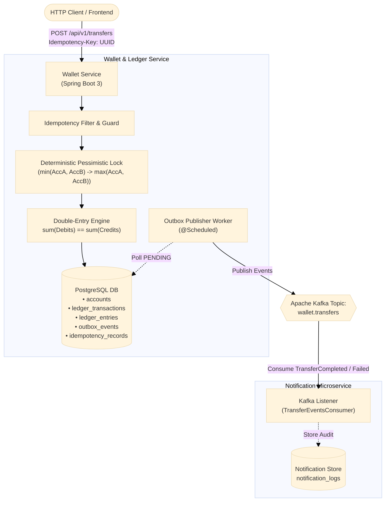

# Enterprise Fintech Wallet & Double-Entry Ledger Service

A production-grade, highly concurrent wallet and payments platform built with **Java 17**, **Spring Boot 3**, **PostgreSQL**, **Apache Kafka**, and **Testcontainers**.

---

## Key Architectural Principles

1. **Double-Entry Ledger Engine ($\sum \text{Debits} == \sum \text{Credits}$)**
   - Every financial movement consists of balanced journal entries.
   - In accordance with standard financial accounting:
     - Customer Wallets are **Liability** accounts (Credit-normal: Credit increases balance, Debit decreases balance).
     - Platform Reserves are **Asset** accounts (Debit-normal: Debit increases balance, Credit decreases balance).
   - Invariant validation: If total debits do not equal total credits, the transaction fails and aborts before database commit with `LedgerInvariantException`.

2. **Idempotency Protection (Zero Double-Charging)**
   - Every mutating transfer requires an `Idempotency-Key` HTTP header.
   - An atomic reservation mechanism with SHA-256 payload hashing ensures that retrying an identical transfer returns the cached response with `200 OK` without duplicating ledger movements.
   - Concurrent duplicate requests receive `409 Conflict`.

3. **Concurrency Control & Deadlock Prevention**
   - Pessimistic write locking (`SELECT ... FOR UPDATE`) prevents simultaneous transfers from overdrawing an account.
   - **Deadlock-Free Locking Order**: To eliminate database deadlocks when bidirectional transfers occur simultaneously (e.g., Thread 1 transfers $A \to B$ and Thread 2 transfers $B \to A$), locks are acquired in a deterministic order based on lexicographical account identifiers.

4. **Transactional Outbox Pattern**
   - Outbox events (`TransferCompletedEvent`, `TransferFailedEvent`) are inserted into the `outbox_events` table **within the exact same database transaction** as the ledger entries and account balance updates.
   - A dedicated `OutboxPublisher` background worker polls pending events, dispatches them reliably to Kafka (`wallet.transfers`), and marks them `PUBLISHED` with retry and backoff handling.

5. **Event-Driven Notification Microservice**
   - A separate decoupled consumer service listens to the `wallet.transfers` Kafka topic.
   - Deserializes completed and failed transfer events and persists audit records in a notification log.

6. **Testcontainers Integration Tests**
   - Real PostgreSQL (`postgres:16-alpine`) and Kafka (`confluentinc/cp-kafka:7.6.0`) run during test execution to validate Flyway schema migrations, pessimistic row locks, outbox streaming, and Kafka consumption.

---

## Architecture Diagram



---

## Project Structure

```
fintech-wallet-ledger/
├── pom.xml                                   # Multi-module parent POM
├── common-events/                            # Shared Kafka event contracts
│   └── src/main/java/com/fintech/events/
│       ├── TransferCompletedEvent.java
│       └── TransferFailedEvent.java
├── wallet-service/                           # Core Wallet & Ledger engine
│   ├── src/main/java/com/fintech/wallet/
│   │   ├── config/                           # Kafka, OpenAPI, and thread config
│   │   ├── controller/                       # REST endpoints
│   │   ├── dto/                              # Request/Response models
│   │   ├── exception/                        # Domain exceptions & Global handler
│   │   ├── model/                            # JPA entities (Account, Ledger, Outbox)
│   │   ├── repository/                       # Spring Data JPA with @Lock
│   │   └── service/                          # TransferService, LedgerService, Outbox
│   ├── src/main/resources/
│   │   ├── application.yml
│   │   └── db/migration/V1__init_schema.sql  # Flyway PostgreSQL migrations
│   └── src/test/java/com/fintech/wallet/
│       ├── ConcurrencyAndLockingTest.java    # 10 concurrent threads overdraw test
│       ├── DoubleEntryLedgerTest.java        # Debits == credits invariant test
│       ├── IdempotencyTest.java              # Replay protection & deduplication test
│       └── WalletTestcontainersIntegrationTest.java # Real Postgres & Kafka test
├── notification-service/                     # Kafka consumer notification service
│   ├── src/main/java/com/fintech/notification/
│   │   ├── config/                           # Kafka consumer configuration
│   │   ├── consumer/                         # Event listener
│   │   ├── controller/                       # Notification logs endpoint
│   │   └── model/                            # NotificationLog entity
│   └── src/main/resources/application.yml
├── docker-compose.yml                        # Postgres, Kafka KRaft, Wallet, Notification, Kafka-UI
├── Dockerfile.wallet                         # Multi-stage container for Wallet Service
├── Dockerfile.notification                   # Multi-stage container for Notification Service
└── render.yaml                               # Render Blueprint for 1-click cloud deployment
```

---

## REST API Specification

### 1. Create a Wallet Account
`POST /api/v1/wallets`
```json
{
  "userId": "usr_9981",
  "accountType": "LIABILITY",
  "currency": "USD",
  "initialBalance": 500.00
}
```

### 2. Deposit Funds
`POST /api/v1/wallets/deposit`
```json
{
  "accountNumber": "WAL1002345678",
  "amount": 250.00,
  "currency": "USD",
  "referenceId": "DEP-77889"
}
```

### 3. Idempotent Transfer
`POST /api/v1/transfers`
**Headers:**
`Idempotency-Key: e8c278e9-4e0e-4c31-90a6-805128ff49e0`
```json
{
  "referenceId": "TX-10001",
  "sourceAccountNumber": "WAL1002345678",
  "destinationAccountNumber": "WAL9887654321",
  "amount": 50.00,
  "currency": "USD",
  "description": "Invoice payment #10001"
}
```

**Response (`200 OK`):**
```json
{
  "transactionId": "b1a7d65b-21d3-4a11-8fc7-9f6b95d9a924",
  "referenceId": "TX-10001",
  "idempotencyKey": "e8c278e9-4e0e-4c31-90a6-805128ff49e0",
  "status": "POSTED",
  "sourceAccountNumber": "WAL1002345678",
  "destinationAccountNumber": "WAL9887654321",
  "amount": 50.00,
  "currency": "USD",
  "description": "Invoice payment #10001",
  "createdAt": "2026-10-17T03:30:00Z"
}
```
*Retrying with the same `Idempotency-Key` returns the identical JSON response immediately without charging the balance again.*

### 4. Query Double-Entry Journal
`GET /api/v1/ledger/transactions/reference/TX-10001`
```json
{
  "transactionId": "b1a7d65b-21d3-4a11-8fc7-9f6b95d9a924",
  "referenceId": "TX-10001",
  "status": "POSTED",
  "entries": [
    {
      "accountNumber": "WAL1002345678",
      "entryType": "DEBIT",
      "amount": 50.0000,
      "currency": "USD"
    },
    {
      "accountNumber": "WAL9887654321",
      "entryType": "CREDIT",
      "amount": 50.0000,
      "currency": "USD"
    }
  ]
}
```
*Note that $\text{Debit} (50.00) == \text{Credit} (50.00)$.*

### 5. Inspect Kafka Notification Dispatches
`GET /api/v1/notifications` (on port 8081)

---

## Running with Docker Compose

Start the full stack (PostgreSQL, Kafka KRaft, Kafka-UI, Wallet Service, Notification Service):

```bash
docker compose up --build -d
```

- **Wallet Service API:** http://localhost:8080/swagger-ui.html
- **Notification Service API:** http://localhost:8081/swagger-ui.html
- **Kafka Web UI:** http://localhost:8085

---

## Free Live Deployment to Render

The repository includes a ready-to-use [`render.yaml`](file:///render.yaml) Blueprint:

1. **Free Managed PostgreSQL:** Render provides a free managed PostgreSQL instance.
2. **Free Managed Kafka (Upstash):**
   - Create a free cluster at [Upstash Kafka](https://upstash.com) (zero credit card needed, free tier with 10k messages/day).
   - Create topic `wallet.transfers`.
   - Copy the `KAFKA_BOOTSTRAP_SERVERS` and `KAFKA_SASL_JAAS_CONFIG`.
3. **Deploy with 1-Click:**
   - Push this repo to your GitHub account.
   - In Render Dashboard: Click **New +** > **Blueprint**.
   - Select your repository.
   - Enter your `KAFKA_BOOTSTRAP_SERVERS` and `KAFKA_SASL_JAAS_CONFIG`.
   - Click **Apply**.
   - Render automatically provisions the PostgreSQL database, builds the multi-stage Docker containers, runs Flyway migrations, and exposes your live HTTPS URLs!
